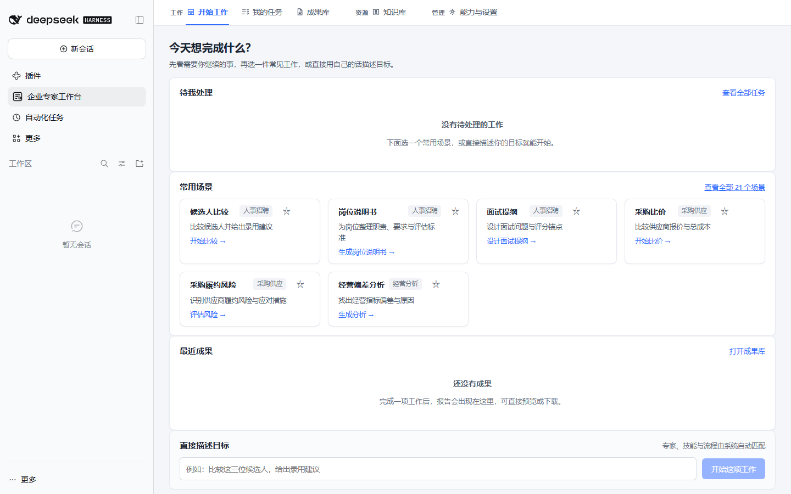
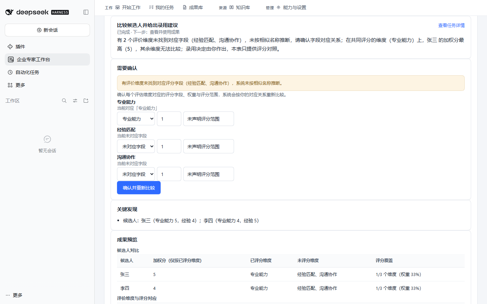

# 企业 AI 专家工作台

> 把企业里的“问一问 AI”，变成可以持续推进、核对依据并交付文件的真实工作。

`dsh-enterprise-expert-workspace` 是一个面向 DeepSeek Harness（DSH）的企业工作台插件。它不是一个只会回答问题的“对话专家”，而是一套围绕**任务、资料、流程、知识和成果**组织的业务执行系统：用户选择场景或描述目标，补充必要资料，系统完成计算、整理与分析，明确未知项，并交付可以预览、下载、继续修改和追溯来源的成果。

适合希望把 AI 用进日常经营、人力、销售、采购、数据、文档和知识管理流程的团队，也适合需要在本地 DSH 环境中保留任务状态与业务资料的个人用户。



## 它能帮你完成什么

| 业务方向 | 典型任务 | 交付成果 |
|---|---|---|
| 知识管理 | 导入资料、检索原文、审核知识、沉淀案例与 SOP | 可追溯知识条目、案例卡、SOP、引用依据 |
| 人力资源 | 提取简历、设计面试、比较候选人、编写 JD、制定入职计划 | 候选人对比表、面试题、JD、入职清单 |
| 个人工作 | 拆解目标、制定周计划、整理会议行动项、复盘与汇报 | 任务计划、行动清单、周报、复盘报告 |
| 经营管理 | 诊断问题、梳理责任、制定改进方案、形成经营报告 | 诊断结论、责任矩阵、改进计划、经营报告 |
| 大客户销售 | 客户研究、机会梳理、拜访准备、销售材料、项目辅导 | 客户地图、机会卡、拜访计划、销售材料 |
| 市场研究 | 研究计划、资料收集、证据核验、机会筛选、报告输出 | 研究框架、机会清单、证据表、研究报告 |
| 数据分析 | 数据画像、清洗、指标计算、差异比较、图表说明 | 指标表、差异清单、数据质量说明、分析结论 |
| 文档处理 | 内容提取、文档比较、按模板成文、多格式交付 | Word、Excel、PPT、PDF、Markdown 等成果 |
| 采购管理 | 需求澄清、供应商扫描、报价比较、TCO、风险评估 | 比价表、总成本分析、供应商风险台账 |
| 数据治理 | 资产盘点、分类分级、标准与质量规则、治理路线图 | 数据目录、分类结果、规则清单、治理计划 |

内置 **10 个业务方向、61 个 Skill、13 条跨领域工作流**。场景不是固定的一次性问答：任务可以暂停、补资料、恢复、重新计算、形成新版本，并进入成果库或知识库。

## 为什么它不是“另一个聊天机器人”

- **从目标到成果**：以任务为中心，资料、参数、执行状态和交付文件在同一条链路中管理。
- **缺什么就问什么**：只追问影响执行的必要信息；已上传资料、已填字段和草稿会保留。
- **不替用户编事实**：结论、已知事实、假设、缺口和下一步分开呈现；资料不足时不会伪装成已完成。
- **关键计算可核对**：采购比价、候选人比较、数据指标等场景先做结构化计算，再由模型解释；模型结论与计算冲突时进入人工确认。
- **口径不一致就停止硬比**：币种、数量、范围、税费或评分字段不一致时，不给出虚假的总体优选，并允许在原任务中修正后重算。
- **交付真实文件**：生成的成果会重新打开并校验，不以“已生成”文字代替实际文件。
- **工作可以继续**：任务、草稿、成果版本、知识条目和审核状态持久化保存，刷新或重启后仍可续做。



## 一条典型操作路径

1. 在首页选择“候选人比较”“采购比价”“项目复盘”等场景，或直接描述目标。
2. 上传 Word、Excel、PDF 等资料，也可以粘贴文本或手工录入结构化字段。
3. 工作台检查资料是否足够；有缺口时只要求补充必要项。
4. 确认口径后执行。确定性计算、资料整理和模型分析会分别记录。
5. 在结果页查看结论、关键发现、依据、待确认项和对比表。
6. 下载 Word、Excel、PPT、PDF、Markdown、CSV、JSON 或 TXT 成果；也可将审核后的内容收入知识库。
7. 未完成事项在“我的任务”继续，历史交付在“成果库”查看来源与版本。

## 快速安装

### 环境要求

| 项目 | 支持范围 |
|---|---|
| Node.js | `>=20.16.0` |
| DeepSeek Harness | `>=0.2.1-rc.5 <0.3.0` |
| 已实测环境 | DSH `0.2.1-rc.5`、Node.js `24.22.1`、Windows、Chrome 157 |
| 客户端 | DSH Web；Desktop 请使用其实际启动的 profile |

兼容范围来自真实安装和运行验证，不把尚未测试的版本写成“已兼容”。

### 安装到 Web profile

```sh
dsh plugin --profile web add dsh-enterprise-expert-workspace
```

安装完成后重启对应 profile，并刷新页面。左侧栏出现“企业 AI 专家工作台”，即表示 Host 与 Web 客户端均已加载。

如果 Desktop 使用的不是 `web` profile，请替换为实际 profile 名称：

```sh
dsh plugin --profile <profile-name> add dsh-enterprise-expert-workspace
```

### 第一次使用

打开“企业 AI 专家工作台”后，先选一个明确场景，上传你有权处理的资料，再按页面提示确认必要字段。无需选择“专家”或理解 Skill 名称；工作台会根据场景路由到相应能力。

## 支持的资料与成果格式

| 格式 | 读取 | 生成 | 说明 |
|---|---:|---:|---|
| Markdown / TXT | ✓ | ✓ | 适合正文、报告与轻量交付 |
| CSV / JSON | ✓ | ✓ | 适合结构化数据交换 |
| Word `.docx` | ✓ | ✓ | 提取正文并生成可编辑文档 |
| Excel `.xlsx` | ✓ | ✓ | 读取工作表并生成真实表格文件 |
| PowerPoint `.pptx` | ✓ | ✓ | 提取幻灯片文字并生成演示文稿 |
| PDF | ✓ | ✓ | 支持有文本层的 PDF；扫描件暂不含 OCR |

上传单文件读取上限为 25 MiB。公开发行版不附带本机知识原件、书籍摘录、私人业务数据、账号或密钥；用户应只导入自己有权使用的资料。

## 模型、数据与权限

### 模型配置

插件通过 DSH 当前 profile 的 `llm` 服务调用模型，不保存 API Key，也不会在本机寻找或复制明文密钥。模型配置位置以 DSH 客户端为准。

没有可用模型时，确定性计算、文件解析和资料整理仍可运行；需要模型分析的部分会明确显示未生成，不会冒充真实模型结果。

可选环境变量：

| 变量 | 用途 |
|---|---|
| `EEW_DATA_DIR` | 指定业务数据目录；默认 `$DSH_HOME/enterprise-expert-workspace` |
| `EEW_MODEL_PROVIDER` | 指定模型提供方路由名，不是密钥 |
| `EEW_MODEL_NAME` | 指定模型名称，不是密钥 |

### 数据存放

- 任务、草稿、成果、知识和用户技能存放在 profile 对应的数据目录，不写入插件安装目录。
- 升级插件不会主动删除业务数据；卸载 bundle 也不会自动清空数据目录。
- 数据可能包含敏感业务信息。请按组织要求配置 profile 访问权限、备份、保留期限和磁盘加密。

### 联网与外部动作

- 插件自身不做广告追踪，不上传遥测数据。
- 只有在 DSH 已配置模型服务且任务需要模型分析时，相关提示与任务资料才会发送给该模型提供方。
- `connectors.configure` 与 `external.action` 默认拒绝；连接业务系统或产生外部副作用需要显式授权。
- 公开版不预置真实业务系统凭据，也不声称未验证的连接已经可用。

## 升级与卸载

升级：

```sh
dsh plugin --profile web update dsh-enterprise-expert-workspace
```

卸载：

```sh
dsh plugin --profile web remove dsh-enterprise-expert-workspace
```

升级前建议备份 `$DSH_HOME/enterprise-expert-workspace`。需要删除业务数据时，请先确认 profile、目录和备份，再单独处理；卸载命令不会替你删除这些数据。

## 常见问题

### 安装后没有看到侧栏入口

确认插件安装到了实际启动的 profile，重启该 profile，再刷新客户端。仅把源码放进目录不等于 bundle 已激活。

### 提示 DSH 版本不兼容

使用 README 中已声明的 DSH 范围。不要绕过兼容检查强行安装。

### 模型不可用或只有结构化结果

在 DSH 中配置模型提供方与凭据，并确认当前 profile 可以调用；不要把密钥写进插件源码、环境示例或知识库。

### PDF 没有提取到文字

扫描版 PDF 没有文本层，当前版本不含 OCR。请先完成 OCR，或改为上传可复制文本的 PDF、Word 或图片识别结果。

### 比较结果提示“需要确认”

这通常不是故障，而是数量、币种、费用范围、评分字段或数据覆盖不一致。按结果页提示修正口径，再在原任务中重新计算。

### 业务系统连接不可用

公开版没有企业内部系统账号与凭据。连接器需要按组织政策单独配置，并在测试 profile 中验证。

## 对开发者与审核者

插件以标准 DSH bundle 形式发布：

- `package.json` 通过 `dsh.bundle.patch` 指向 `cordis.patch.yml`。
- `cordis.patch.yml` 注册 Host 模块；`index.js` 提供 Host 能力；`client.js` 注册 Web 工作台。
- 仅声明源码实际使用的运行依赖；DSH 兼容范围由 `engines.dsh` 明确约束，不制造未使用的 peer 依赖。
- 发布包仅包含运行源码、配置、Skill、文档、图片和许可证，不包含测试 profile、日志、凭据或私人知识资料。

本地验证：

```sh
pnpm install --frozen-lockfile
pnpm run verify:all
pnpm pack --pack-destination dist
pnpm run verify:package
pnpm run verify:archive
```

正式发布前还必须在隔离 DSH profile 中从生成的 `.tgz` 安装、启动并完成一次核心任务；源码链接安装不能替代发行包验证。架构说明见 [docs/ARCHITECTURE.md](docs/ARCHITECTURE.md)，市场提交资料见 [docs/MARKET_SUBMISSION.md](docs/MARKET_SUBMISSION.md)。

## 项目与反馈

- GitHub：<https://github.com/shudi729/dsh-enterprise-expert-workspace>
- npm：<https://www.npmjs.com/package/dsh-enterprise-expert-workspace>
- 问题反馈：<https://github.com/shudi729/dsh-enterprise-expert-workspace/issues>
- 安全问题：请使用 GitHub 私密漏洞报告，不要在公开 Issue 中粘贴密钥、客户数据或原始业务文件。

## 许可证

项目源码采用 [MIT License](LICENSE)。第三方运行依赖保留各自许可证；说明见 [THIRD_PARTY_NOTICES.md](THIRD_PARTY_NOTICES.md)。
